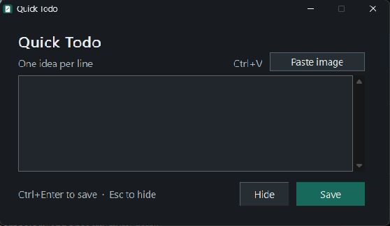

# Quick Todo

A small native Windows application that captures ideas through a global shortcut and appends them as tasks to an existing Markdown file.


Press **Ctrl+Alt+T**, type one idea per line, then press **Ctrl+Enter**. Quick Todo appends unchecked Markdown tasks and hides its window. It waits for Windows messages while idle; it has no polling timer, browser engine, background PowerShell process, or runtime network requests.



The compact native window uses a dark background, readable Segoe UI text, a teal Save button and visible keyboard hints. Windows supplies the title bar and native editor controls, including the high-contrast presentation.

## Daily use

| Action | Control |
| --- | --- |
| Open the capture window | Ctrl+Alt+T, tray icon, or launch the executable |
| Attach a copied screenshot | Ctrl+V or Paste image |
| Save every nonempty line as a task | Ctrl+Enter or Save |
| Start another idea on a new line | Enter |
| Hide and keep the current draft | Escape, Hide, or the window close button |
| Open the target file in its associated application | Tray menu → Open Todo.md |
| Stop the application | Tray menu → Quit |

For example, entering:

```text
Add keyboard search to the inventory app
Remember recently viewed artists
```

appends:

```markdown
- [ ] Add keyboard search to the inventory app
- [ ] Remember recently viewed artists
```

Existing notes are preserved byte for byte, including their UTF-8 BOM and LF or CRLF line endings. Input bullets (`- `, `* `, and `- [ ] `) are normalized so they are not duplicated. Empty input does nothing. Drafts remain in memory while the application runs; quitting prompts before discarding a draft.

### Capture a screenshot

Take a snip with **Win+Shift+S**, open Quick Todo with **Ctrl+Alt+T**, and paste with **Ctrl+V**. The editor shows **Screenshot attached**. Add a description and save with **Ctrl+Enter**. Use **Remove image** to clear the attachment, or paste another image to replace it. A copied text selection still pastes as text.

Each draft holds one screenshot. Saving writes a PNG into `quick-todo-attachments` beside the configured Markdown file and embeds it below the first task. An image without a description saves as a task named `Screenshot`. Quick Todo accepts PNG and Windows clipboard bitmaps up to 40 million pixels, with a 32 MiB limit on the saved PNG.

## Configure and install

The application runs on Windows 10/11. A compiled executable needs no Rust installation. Keep `config.txt` next to `quick-todo.exe`:

```ini
target=C:\path\to\your\vault\Todo.md
```

You can copy [config.example.txt](config.example.txt) and change its target. Your local `config.txt`, notes and build tools are excluded from Git.

The target must already exist and contain UTF-8 text. Its parent folder is never created automatically. The shortcut is fixed at Ctrl+Alt+T in this version. If another application has registered it, Quick Todo shows an error instead of silently failing.

From PowerShell in this project directory, create a Start menu shortcut and optionally enable hidden startup at sign-in:

```powershell
.\install.ps1 -TodoPath 'C:\path\to\your\vault\Todo.md' -StartAtLogin
```

The installer creates shortcuts for the current user and starts Quick Todo hidden. Run the executable or press the shortcut to show its window. To disable automatic startup, remove only the `Quick Todo.lnk` shortcut from the current user's Windows Startup folder. Quit from the tray to stop the currently running process. To change the target, quit the app, edit `config.txt`, and launch it again.

Command-line options:

```powershell
.\quick-todo.exe                       # Show the window, or show the existing instance
.\quick-todo.exe --hidden              # Start in the tray
.\quick-todo.exe --file 'C:\notes\Todo.md' # Override config for a new instance
.\quick-todo.exe --quit                # Ask the running instance to quit
```

Only one instance runs per Windows session. A second launch activates the first instance and retains its original file target.

## Build and verify

Source: [native window and shortcuts](src/main.rs), [native controls and styling](src/ui.rs), [Windows clipboard images](src/clipboard.rs), [task and attachment storage](src/append.rs), [Windows resource build](build.rs).

The note/checkmark icon is embedded in the executable for the taskbar, window and tray. Its [vector artwork](resources/quick-todo.svg) and [Windows icon](resources/quick-todo.ico) are included. To regenerate the icon and PNG preview using Windows' built-in drawing library:

```powershell
.\scripts\generate-icon.ps1
```

Development requires Rust with Cargo, rustfmt and Clippy, plus a Windows linker and resource compiler. The existing local setup uses the `stable-x86_64-pc-windows-gnu` Rust toolchain under `.toolchain` and [w64devkit](https://github.com/skeeto/w64devkit) for its GNU assembler, linker and resource compiler. These are build tools and do not run with the installed app. Alternatively, build in a Visual Studio developer shell with the Rust MSVC toolchain, C++ tools and Windows SDK.

For a fresh checkout, install Rust's MSVC toolchain and the Visual Studio C++ build tools with a Windows SDK, then open a developer PowerShell and run:

```powershell
git clone https://github.com/Gehrman-Sparrow42/quick-todo.git
cd quick-todo
rustup component add rustfmt clippy
.\build.ps1
.\install.ps1 -TodoPath 'C:\path\to\your\vault\Todo.md' -StartAtLogin
```

```powershell
.\build.ps1            # Format check, Clippy, tests, release build, deploy
.\build.ps1 -CheckOnly # Same checks and build; leave the installed executable alone
```

Quit Quick Todo before deploying a rebuilt executable. The build script refuses to replace an executable that is currently running.

The tests cover existing content preservation, newline styles, UTF-8 BOM, Turkish characters, bullet normalization, blank input, empty files, missing targets, invalid encodings, file sharing conflicts, screenshot placement and Windows bitmap encoding. They use temporary files inside `target/test-files`, never the configured notes file.

## Saving and failure behavior

During a save, Quick Todo opens the existing target with other writers and renames excluded, validates its encoding, appends tasks and flushes the write. If a write or flush fails, it attempts to truncate only the newly appended bytes back to the original length. Errors preserve the editor draft. If rollback also fails, the message explicitly asks you to inspect the file before retrying.

For a draft with an image, Quick Todo writes and flushes the PNG before appending its link. If a failed note append is rolled back, the app removes the new PNG. When rollback fails, the app keeps the PNG available for any link already written.

The file lock protects the short append operation. A separate editor can still later overwrite the file using an older unsaved copy; reload external changes before saving such a copy. Drafts are not persisted across process termination or Windows sign-out.
